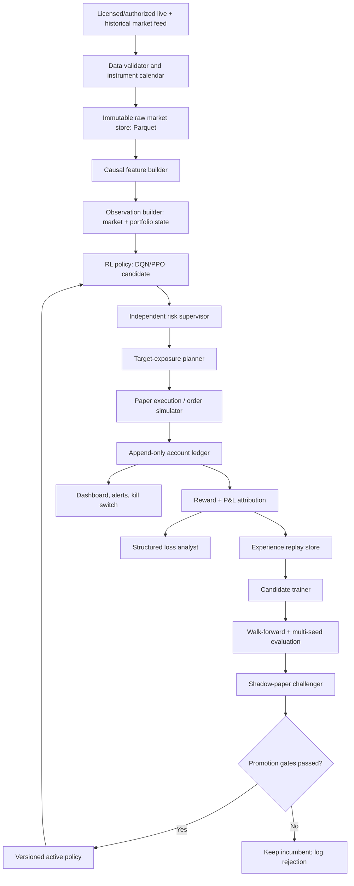

# Self-Improving Paper Trading Agent — Research and Architecture Blueprint

**Prepared:** 19 October 2026  
**Target:** Indian equities / NSE-style intraday paper trading, initially using a virtual INR account such as ₹10,000  
**Goal:** An initially untrained reinforcement-learning agent observes real markets, chooses trades, learns from simulated outcomes, diagnoses losses, and improves through evaluated model updates.  
**Scope:** Research/engineering plan, not financial advice or a claim of profitability.

---

## 0. Executive decision

Build a **reinforcement-learning trading system with a genuine market-data feed, a realistic paper broker, an append-only account ledger, an experience replay store, and a gated model-improvement pipeline**. Do not continue treating synthetic candles plus a supervised classifier as a trading system.

The desired loop is:

1. A paper account is initialized with a chosen balance.
2. The agent observes real market data and its own account state.
3. It proposes a target portfolio exposure.
4. A risk supervisor validates or clips the action.
5. A paper execution engine simulates fills and charges realistic fees.
6. The ledger computes the actual post-cost portfolio result.
7. The transition is saved to the RL experience store.
8. At scheduled intervals, a candidate policy trains on historical replay and accumulated paper experience.
9. The candidate is compared with the incumbent on unseen data and in shadow-paper mode.
10. The incumbent is replaced only if explicit evaluation and risk gates pass.

**Important limitation:** A balance alone contains no information about future price changes. The agent must at least receive market observations (prices/volume and preferably spread/quotes), instrument metadata, and a result/reward signal. Starting with no trading strategy is feasible; starting with no market data is not.

Recommended first version:

- Market: cash equities only; no leverage, short selling, options, futures, or borrowed funds.
- Timeframe: start with completed 5-minute candles, with execution at the next tradable event/bar—not the same candle close used to make the decision.
- Universe: a small, explicitly defined, liquid, point-in-time-valid group of instruments; avoid optimising across a hand-picked list of today's winners.
- State: market features + cash/holdings/equity/drawdown/open orders/time-in-session.
- Action: discrete target exposure levels, including **do nothing**.
- RL candidates: Double DQN for the initial discrete action space; compare with PPO. Consider SAC only after the action space genuinely needs continuous weights.
- Reward: change in log portfolio equity after all simulated transaction costs, with hard independent risk constraints and a measured drawdown penalty if needed.
- Training: randomised episodes over real historical market paths, random starting dates and balances; then live-market paper experience.
- Learning: candidate training in the background; never let an unvalidated online weight update immediately control the active account.

## 1. What the research says

### Financial RL is feasible, but validation is the hard problem

FinRL-Meta describes a layered architecture—data, environment, and agent—and a standard trading state including cash, holdings, prices, volume and indicators. It characterises financial RL as difficult because market signals are noisy, historical universes can suffer survivorship bias, and repeated backtest tuning can overfit. It also discusses market frictions, cash constraints and risk controls. Sources:

- Paper: https://arxiv.org/abs/2211.03107
- Official repository: https://github.com/AI4Finance-Foundation/FinRL-Meta

### “No offline training” has been studied, but is not production proof

Boian Lazov’s *A Deep Reinforcement Learning Trader without Offline Training* studies Double Q-learning with a Fast Learning Network and an episodic capital-management mechanism. The 2025 journal version reports tests on one-minute data for four Binance cryptocurrencies and better results than random actions on the historical data. This is directly relevant to the desired cold-start idea, but the evidence should be interpreted narrowly: historical simulation, a specific set of crypto assets, and a random-action comparator do not establish durable net profitability on NSE equities or under real execution conditions.

- 2025 journal page: https://www.sciencedirect.com/science/article/pii/S1568494625011949
- Author preprint: https://arxiv.org/abs/2303.00356

### The system should have a deployment-consistent interface

The 2026 FinRL-X work advocates a modular pipeline connecting data processing, strategy construction, backtesting and execution through a target-portfolio-weight interface. Its current repository includes data, strategy, backtest and execution layers, with examples tied to providers such as Alpaca; it is a useful architecture reference, not an out-of-the-box India/NSE broker integration.

- Paper: https://arxiv.org/abs/2603.21330
- Official repository: https://github.com/AI4Finance-Foundation/FinRL-Trading

### Offline RL is a possible later research branch

Conservative Q-Learning (CQL) targets a known problem in offline RL: a learned policy can assign unrealistically high value to actions poorly represented in the dataset. It is conceptually relevant if the agent eventually learns from logged actions without interacting with every action in the environment, but it is not needed to ship the first MVP.

- Paper: https://arxiv.org/abs/2006.04779

### Backtest results need protection against selection bias

Repeatedly changing models/hyperparameters until one performs well on the same test period can make the best result a statistical fluke. Bailey and colleagues describe Probability of Backtest Overfitting (PBO) and combinatorially symmetric cross-validation; the Deflated Sharpe Ratio adjusts for multiple testing and non-normal returns. Treat these as research tools rather than magic guarantees.

- PBO: https://papers.ssrn.com/sol3/papers.cfm?abstract_id=2326253
- Deflated Sharpe Ratio: https://doi.org/10.3905/jpm.2014.40.5.094

### Practical paper-trading simulators are still approximations

Alpaca’s official paper-trading documentation explicitly notes that paper and live performance can differ, including due to market impact, information leakage, latency slippage, limit-order queue position, price improvement, regulatory fees and dividends. Those limitations are general execution-simulation concerns even though Alpaca is not the recommended NSE execution API.

- https://docs.alpaca.markets/us/v1.4.2/docs/paper-trading

## 2. Proposed system architecture



### Component boundaries

**1. Market data service**  
Ingest historical and real-time market data, normalise timestamps, map broker instrument identifiers, and detect missing, duplicated, stale or impossible records. Preserve raw source data so a model result can be reproduced later.

**2. Feature service**  
Generate only features that would have been available by the decision timestamp. Use causal rolling calculations, explicit `shift`s, train-only scaling and versioned feature definitions. Feature code used in research, paper mode and future live mode must be the same version.

**3. Environment / simulator**  
Implements the Gymnasium `reset()` / `step()` interface, portfolio accounting, action constraints, fill simulation, charges, episodes and terminal liquidation. Gymnasium’s environment API and checker are useful references: https://gymnasium.farama.org/introduction/create_custom_env/ and https://gymnasium.farama.org/v1.0.0/api/env/.

**4. Policy**  
Receives a typed observation and returns a requested target exposure. It has no access to broker credentials, no ability to amend risk limits, and no direct order-placement method.

**5. Risk supervisor**  
Applies deterministic, independently tested constraints after the policy acts. Example: maximum gross exposure, position cap, cash sufficiency, permitted symbols, no-leverage rule, loss lockout, market-hours checks and stale-feed lockout.

**6. Execution adapter**  
Initially a fully local paper broker. Later, if appropriate, a broker-specific adapter can be added behind the same order interface. It handles acknowledgements, partial fills, rejections, timeouts, order IDs and reconciliation.

**7. Ledger/accounting**  
The ledger—not the RL model—is the source of truth for cash, positions, average price, realised P&L, unrealised P&L, fees, equity and account high-water mark. Do not recalculate money with separate inconsistent logic inside multiple notebook cells.

**8. Learning service**  
Collect transitions continuously, but train candidate models separately from the process choosing active paper actions. Save model weights, feature schema, dataset version, seeds, training code version, reward configuration and evaluation report.

**9. Loss attribution service**  
Calculate why money was lost as far as observable data allows: adverse price movement, spread/slippage, commissions/taxes, delayed/partial fills, excessive turnover, sizing and portfolio concentration. An optional LLM may verbalise these structured facts, but it cannot invent causes or place orders.

## 3. Formalise the task as a partially observable Markov decision process

Markets are not fully observable: the agent never has the full future order flow, all participants’ intentions or the true probability distribution of the next move. A POMDP-style formulation is therefore more honest than pretending the current candle tells the complete state. The policy can still use a finite recent lookback window or a recurrent model.

### 3.1 State / observation

At decision time `t`, define:

`o_t = [x_t, p_t, c_t, q_t, d_t, u_t, z_t]`

where:

- `x_t`: causal market features—recent log returns, realised volatility, candle range, volume relative to a trailing baseline, distance from intraday VWAP, broad-market return, market regime proxies, and spread/order-book features when legitimately available.
- `p_t`: instrument prices and tradability metadata (tick size, lot size if relevant, price bands, trading status).
- `c_t`: available cash divided by current equity.
- `q_t`: holdings/exposure per instrument, preferably represented in portfolio-weight or equity-normalised form.
- `d_t`: drawdown from the account’s high-water mark.
- `u_t`: current unrealised P&L, realised daily P&L, recent costs, turnover and pending-order state.
- `z_t`: session/time features, time to close, recent data freshness and risk mode.

Include **portfolio state**. A policy that observes prices but not its current holdings can repeatedly ask to buy something it already owns or fail to account for liquidation costs.

Do not hand the model future high/low/close values for the candle in progress. A feature at `t` must be constructed from data published by `t` only.

### 3.2 Action space

Start with target exposure, not raw unconstrained order quantities. For one asset, for example:

`a_t in {0%, 25%, 50%, 75%, 100%}`

Those are requested fractions of equity allocated to the permitted long position; `0%` means cash/no position. The independent risk supervisor may restrict the maximum or reject the action. This small discrete action space makes a DQN-family agent straightforward and limits the damage random exploration can cause inside the simulator.

For a small multi-asset portfolio, actions can later be target weights `w_t` over each asset plus cash, with constraints such as:

- `w_i >= 0` for long-only
- `sum_i w_i <= 1`
- `w_i <= single-name cap`
- cash reserve and liquidity constraints
- turnover and order-size constraints

Use a common downstream interface: `requested_target_weights -> risk-adjusted_target_weights -> orders`. This keeps research, paper execution and any later permitted broker execution semantically aligned.

### 3.3 Random starting balances

For training episodes, sample starting cash over a useful range, e.g. log-uniformly from ₹5,000 to ₹50,000, while keeping the real paper account’s starting balance at the chosen amount (such as ₹10,000). Do not mix INR and USD in the same environment. The range is a starting experimental configuration, not a universal recommendation.

Represent cash and positions as fractions of equity as well as rupee values; otherwise the model can overfit to one nominal account size. But the simulator must retain actual rupee amounts because charges, whole-share quantities and tick sizes do not scale continuously.

For Indian cash equities, shares are generally indivisible; quantity is rounded to whole shares and may become zero if a share is too expensive. This is important for a small starting balance. The policy must support “cannot afford a share” as a valid no-trade result—not force a trade.

## 4. Portfolio math, fills and reward

### 4.1 Account equity

For cash `C_t`, share quantity `q_{i,t}`, and mark price `P_{i,t}`:

`E_t = C_t + sum_i(q_{i,t} * P_{i,t}) - liabilities_t`

For a strictly cash-only long-only MVP, liabilities should remain zero. Define high-water mark `H_t = max(H_{t-1}, E_t)` and drawdown `D_t = 1 - E_t / H_t` (provided `H_t > 0`). Track the ledger in integer paise where possible to avoid floating-point rounding drift in monetary totals.

### 4.2 Position sizing

Given target weight `w_i`, equity `E_t`, price `P_i`, and a reserve for costs:

`q_i_target = floor((w_i * E_t) / (P_i * (1 + cost_reserve_fraction)))`

Then clamp it to current cash sufficiency, permitted position caps, liquidity limits, whole-share rules, lot/tick requirements and risk limits. Use a conservative cost reserve and recalculate after actual simulated fills.

Orders should bring the portfolio toward a target, not blindly submit the same BUY every time the model emits “buy”. If a pending order already moves exposure toward that target, the planner should avoid duplicate orders.

### 4.3 Execution timing and pricing

For candle-based testing, if the decision uses candle `t`’s completed close, do **not** fill at that same close unless the simulation correctly models an order that could actually have been submitted and filled before that close. The safe default is the next bar’s open or next available eligible quote, with adverse execution costs. Large overnight or bar-to-bar gaps must affect fill prices.

A simple bar-based fill model can begin with:

- BUY execution price = next observable reference price + half-spread + adverse slippage/impact
- SELL execution price = next observable reference price − half-spread − adverse slippage/impact

Where true bid/ask data is unavailable, estimate spread and impact conservatively, and run stress scenarios. OHLCV alone cannot realistically reconstruct queue position or exact intrabar fills. For limit orders, do not assume a fill merely because a candle’s high/low touches the limit; require a conservative trade-through/volume rule or start with a simpler order type.

### 4.4 Cost model

Every simulated order must apply the relevant versioned cost schedule. For Indian equities, the configuration may include:

- broker brokerage (broker- and segment-specific)
- securities transaction tax (STT)
- exchange transaction charges and applicable IPFT charges
- SEBI turnover fees
- GST on applicable fee components
- stamp duty on the applicable side
- slippage and estimated market impact
- any applicable DP/delivery or other charges

Use the broker’s published charge schedule/calculator and keep rate tables versioned by effective date. Don’t freeze a rate from an old web page into the code permanently. Official examples: [Zerodha charges](https://zerodha.com/charges), [Upstox brokerage charges](https://upstox.com/brokerage-charges/?hl=en_IN), [NSE data-sharing policy](https://www.nseindia.com/static/market-data/nse-data-policy).

Cost calculations must be applied **once and only once**. Choose either prices that already include spread/slippage and separately charge fees, or raw reference prices and a separately recorded execution-cost item. Do not bake slippage into execution prices and charge the same slippage again.

### 4.5 Reward function

A strong MVP reward is net log-equity growth:

`r_t = log(E_{t+1} / E_t)`

where `E_{t+1}` is computed after simulated fills and all applicable transaction costs. Require `E_t > 0`; handle bankruptcy/invalid equity as a terminal safety event rather than letting `log(0)` or NaN leak into training.

Optional risk-shaped reward:

`r'_t = r_t - lambda_D * max(0, D_{t+1} - D_t)`

This penalises increases in drawdown. Introduce it only after the basic ledger and reward have passed unit tests. Keep hard exposure/loss limits separate from a soft reward penalty. Do not rely on a reward penalty alone to stop unsafe actions.

Do not blindly add a “trading cost penalty” on top of costs already deducted from equity: that can double-count costs. A separate turnover regulariser may be tested, but label it as an intentional behavioural penalty, not actual transaction cost.

Do not optimise per-trade win rate. A strategy can win frequently and still lose money after losses and fees. Do not directly use a noisy single-trade outcome as a categorical instruction that the action was wrong. RL updates estimate expected cumulative reward from many transitions; one losing trade can occur under a good policy.

### 4.6 Evaluation metrics (not all training rewards)

Track net return, daily-return Sharpe and Sortino, maximum drawdown, Calmar ratio, expected shortfall/CVaR, exposure, turnover, percentage of gross profit consumed by costs, expectancy per trade, win/loss size, rejected/partial orders, and time spent in cash. Use daily portfolio returns for many performance summaries rather than incorrectly annualising five-minute observations with a guessed constant.

Compare to at least: no-trade/cash, a simple rule-based intraday baseline, and a relevant benchmark for the actual holding style. Random actions are a sanity check, not a sufficient competitor.

## 5. The self-improvement loop

### Step 1 — Start untrained, but learn in a safe environment

To preserve the intended “no hand-coded trading strategy” idea, begin with randomly initialised policy parameters and train through RL rewards in a historical replay simulator using real market observations. This is not supervised prediction: the agent is not given “buy/hold/sell” labels. It explores actions, sees the consequences under the simulator and updates its policy.

If “zero historical training” is a hard requirement, the agent can start from an untrained policy and learn only from a live paper feed, but that is a much harder research path. It sees only one evolving live market path, has limited samples, cannot safely explore every action, and has difficulty separating market noise from action quality. The no-offline-training paper cited above is worth reproducing as a controlled experiment, not assumed to prove that pure online learning will work for NSE.

### Step 2 — Collect the transition tuple

After each completed environment step, store:

`(observation_t, action_t, reward_t, observation_t+1, terminated, truncated, timestamp, market_version, policy_version, execution_record)`

Also keep the complete human-auditable order/fill/fee ledger. Do not store only a narrative such as “bought because momentum looked good”; the action, input features, policy version and actual outcome are the essential source of truth.

### Step 3 — Replay and train a challenger

Use a replay buffer to sample transitions from many market dates and balance sizes, not just the last few paper trades. Include a strategy for recency and regime coverage; excessive recency can forget older regimes, while excessive historical weighting can ignore new conditions. Version replay sampling settings and monitor which observations are being sampled.

Train a **candidate** policy on a schedule (for example after market close or after a configurable volume of new observations). Don't update the active decision model on each raw fill in the first release. A trade outcome is noisy; a poorly controlled update can lead to catastrophic forgetting or policy oscillation.

Initial candidate algorithms:

- **Double DQN / DQN family:** fits a small discrete target-exposure action space; experience replay helps reuse transitions. Double DQN is a useful research variant to reduce overestimation relative to a basic DQN.
- **PPO:** a credible benchmark for discrete or continuous policy learning, but on-policy learning generally reuses experience differently and is not automatically the best online learner.
- **SAC:** consider later if continuous exposure weights become essential; it adds complexity and a stochastic/entropy-driven exploration objective.

Stable-Baselines3 documents action-space support and DQN replay-buffer controls: https://stable-baselines3.readthedocs.io/en/md-doc/guide/algos.html and https://stable-baselines3.readthedocs.io/en/sde/modules/dqn.html. Algorithm choice must be determined experimentally on the same chronological splits and reward/fee setup.

### Step 4 — Evaluate without peeking

Use chronological walk-forward evaluation:

- Train on earlier data.
- Validate on a later block for model choice and reward configuration.
- Leave a final, untouched test block for a final assessment.
- Repeat through several rolling windows to see whether performance survives different regimes.
- Purge/embargo boundaries when labels, holding periods or observation windows can overlap across splits.
- Run multiple random seeds and publish median plus dispersion, not only the best run.
- Keep a log of every strategy/hyperparameter trial; repeated search is itself a source of overfitting.

For online paper performance, run the candidate as a **shadow account** alongside the incumbent on the same incoming market feed, using separate virtual cash/positions and identical cost assumptions. This creates a fairer comparison without actually trading either strategy’s proposed orders at the exchange.

### Step 5 — Promotion and rollback

Only promote a candidate when predeclared gates pass. Gates should include:

- no accounting, data-integrity or risk-limit failure;
- positive or otherwise acceptable net performance under the declared evaluation design, after realistic charges;
- drawdown and tail loss inside configured limits;
- enough independent trading sessions/trades for evaluation to be meaningful;
- performance not dependent on one small time period or a single market regime;
- no material deterioration against the incumbent and baselines;
- successful paper-shadow and recovery tests.

There is no universally valid “30 days” or “100 trades” threshold. Sample requirements depend on strategy frequency, variance, market regime and confidence desired. Choose the gate before looking at results. Keep the last accepted policy for rollback. If a candidate fails, log why and keep the incumbent; “self-improving” must include the ability to reject a worse update.

### Step 6 — Detect regime changes, but don't overreact

Monitor feature distributions, missing/stale data, spread, volatility, turnover, rolling net performance and risk metrics. A drift detector such as River’s ADWIN can be a useful signal that a monitored distribution changed (https://github.com/online-ml/river/blob/main/river/drift/adwin.py). A drift alert should trigger reduced risk, diagnostics or extra evaluation—not a blind immediate retrain or automatic live-policy replacement.

## 6. “Learn why a loss happened” — a measurable post-trade report

The system should generate a structured post-trade incident report for every closed trade and daily account result. The report should separate observable mechanics from uncertain market explanations.

For each trade, calculate:

1. gross mark-to-market P&L from entry to exit reference price;
2. execution-price effect (spread/slippage/impact estimate);
3. each fee/tax component;
4. net P&L after costs;
5. holding time and exposure;
6. maximum favourable excursion (MFE) and maximum adverse excursion (MAE) within the defined observation window;
7. price gap between signal time and actual simulated fill;
8. whether the desired position was rejected, partially filled or rounded to zero;
9. the market features known at decision time and the exact model/version/action;
10. comparison with the incumbent or baseline’s shadow result, clearly labelled as counterfactual—not a guaranteed achievable fill.

At the portfolio level, attribute P&L by instrument, time of day, regime proxy, action/exposure level, turnover and cost ratio. Ask questions such as “Did fees consume the gross edge?”, “Was a large loss caused by a gap after the decision?”, “Did performance deteriorate during high volatility?”, and “Did the policy repeatedly reverse position and churn?”

Do not assert that the agent “learned the market moved because of X” unless the system has a trustworthy event/news feed that supports that explanation. Price-only data often cannot explain the cause of a move. An LLM can turn verified attribution into readable English but must cite the ledger/feature facts it used; it must not invent news or alter the numerical record.

## 7. Edge cases that must be handled explicitly

### Data integrity

- missing or duplicate candles; out-of-order timestamps; time-zone/DST mistakes;
- data feed heartbeat without fresh prices; stale feed; reconnect gap;
- malformed prices, zero/negative prices, impossible OHLC ordering, overflow/NaN;
- missing volume, zero-volume bar, suspended instrument, circuit limit or price band;
- corporate actions, splits, dividends, symbol/name changes, instrument-token changes;
- delisted names/survivorship bias and index membership changes;
- holidays, half sessions, exchange schedule changes and end-of-day behaviour;
- point-in-time feature availability and late-arriving corrections;
- inconsistent raw/adjusted prices and duplicated candles across vendors.

### RL/environment correctness

- feature leakage from a future bar, future close, full-dataset scaler or target leakage;
- accidental sequence or target shift across symbols;
- incorrect `terminated` vs `truncated` episode state;
- episode reset that leaks positions, cash, scaler values or high-water mark from the previous episode;
- reward NaN/Inf, equity <= 0, negative cash or impossible holdings;
- action to buy more than cash permits; fractional quantity in a whole-share market;
- model repeatedly toggles exposure; no-trade action missing;
- action selected on a forming candle but credited with a past price;
- duplicate transitions, timestamp mismatch, or reward paired with wrong action;
- replay buffer dominated by one period/regime or stale transitions;
- model version changes mid-episode without being recorded;
- training/evaluation environments with different cost, fill or data semantics.

### Execution and account reconciliation

- partial fills; order rejected; order cancelled; order remains pending;
- request timeout after broker accepted order (unknown state—never blindly retry);
- duplicate order retry; stale price at decision time; price gap before fill;
- invalid tick/lot size; insufficient funds after charges; rounding to zero quantity;
- a fill received twice or out of order; cancel/modify race;
- WebSocket disconnect, token expiry, API throttling or temporary broker outage;
- forced end-of-session exit, exchange halt or no eligible quote near the close;
- charge schedule changed but simulator still uses old rates;
- paper engine shows a fill despite no available market liquidity;
- realised P&L/fees/cash/equity disagree across dashboard and ledger.

### Learning and operational risk

- one exceptional loss drives an unstable model update;
- candidate improves one metric while worsening drawdown/tail loss;
- “best of 100 models” selected by repeatedly inspecting the final test set;
- strategy performs only in a bull market or on a single symbol;
- random exploration continues in the active account;
- reward encourages excessive turnover, concentration or holding illiquid assets;
- policy learns to exploit simulator bugs or unrealistic fills;
- data/model drift is confused with one ordinary losing trade;
- secrets, API keys or personal account identifiers are stored in notebooks/logs;
- Colab disconnects and drops the streaming client or in-memory account state;
- kill switch stops new orders but forgets to cancel pending ones or flatten/secure positions as designed.

## 8. Risk supervisor: deterministic safeguards outside the model

For the first paper-only environment, configure rules such as:

- cash-only, long-only, no leverage and no derivatives;
- permitted instrument list and trade session schedule;
- maximum weight per instrument and maximum gross exposure;
- maximum order value/quantity and participation limit;
- maximum turnover or minimum time between exposure changes if needed;
- stale-feed lockout and missing-data lockout;
- session-loss and overall-drawdown stop conditions;
- pending-order duplicate protection and idempotent client order IDs;
- terminal/session-close handling;
- one global kill switch which disables new actions and follows a separately specified pending-order/position policy.

Illustrative *paper test* guardrails could be a maximum 25% allocation to one stock, total exposure no greater than 100%, no leverage, and a configured loss lockout. The actual numerical limits are engineering parameters to test and document, not universal trading advice. A small ₹10,000 account may be heavily affected by order minimums and charges; the agent must be permitted to hold cash indefinitely.

Risk rules must not be changed by the RL policy or by an LLM. A risk-rule change is a code/configuration release, versioned and tested separately.

## 9. Data and broker options

### For Indian equities

Potential official-source starting points:

- **Zerodha Kite Connect historical candles:** https://kite.trade/docs/connect/v3/historical/ — candle records include timestamp, OHLC, volume and other fields; five-minute intervals are supported. Zerodha’s pricing page describes Connect with real-time WebSocket and historical candles for ₹500/month: https://zerodha.com/products/api/.
- **Kite WebSocket:** https://kite.trade/docs/connect/v3/websocket/ — real-time quotes, optional market depth and order updates.
- **Upstox V3 market-data feed:** https://upstox.com/developer/api-documentation/v3/get-market-data-feed/ — authenticated real-time WebSocket feed.
- **Official brokerage/cost schedules:** https://zerodha.com/charges and https://upstox.com/brokerage-charges/?hl=en_IN. Store the rates with effective dates and verify before a new run.
- **NSE data policy:** https://www.nseindia.com/static/market-data/nse-data-policy — confirm permitted usage, storage, redistribution and licensing for the data source selected.

A key distinction: an API that supports real orders and market data does not necessarily provide a broker-managed paper account. If the selected India broker does not provide a suitable official paper endpoint, build the paper account locally and consume authorised live/historical data. Make the paper engine visibly separate from the real brokerage order route.

### Current Indian retail-algo consideration

SEBI issued its “Safer participation of retail investors in Algorithmic trading” circular on 4 February 2025; NSE publishes subsequent operational modalities and FAQs. As of the 2026 NSE pages reviewed here, the exchange points to circular NSE/INVG/73992 dated 30 April 2026 and a retail-algo FAQ. The FAQ states, among other things, that API orders are treated as algo orders and covered by identification/tagging rules; it distinguishes client-direct API users from other arrangements, and it describes static-IP requirements for the “tech-savvy investor” API route. It also notes restrictions on market orders for algo orders. Requirements depend on the exact broker/API deployment category and may change, so confirm the current circular and your broker’s implementation before enabling any real orders.

- SEBI circular: https://www.sebi.gov.in/legal/circulars/feb-2025/safer-participation-of-retail-investors-in-algorithmic-trading_91614.html
- NSE detailed modalities page: https://www.nseindia.com/static/trade/platform-services-non-neat-decision-support-tools-algorithm-trading
- NSE FAQ PDF: https://nsearchives.nseindia.com/web/sites/default/files/inline-files/FAQ_Retail%20Algo_03112025_NSE.pdf

For now, keep the system in a self-contained paper environment. Do not point a learning notebook at real order credentials.

## 10. Storage and reproducibility

For an MVP, avoid an unnecessarily complex “AI memory” stack. RL memory is numerical experience data, not a vector search problem.

Suggested persistence:

- `data/raw/` — immutable provider snapshots, partitioned by source/instrument/date;
- Parquet + DuckDB for historical bars and efficient analysis;
- SQLite initially (PostgreSQL later if concurrent services require it) for account ledger, order events, model registry and run metadata;
- replay buffer checkpoint files with schema/version metadata;
- `models/<model_version>/` — weights, feature schema, normalisation config, algorithm config, training seed and dataset hash;
- `runs/<run_id>/` — scores, equity curves, daily returns, trades, fees, warnings and exact code commit;
- append-only event log for observations, actions, risk decisions, simulated orders, fills and model promotions.

A model file by itself is not reproducible. The exact feature code, data version, action mapping, reward formula, fees and execution engine version must also be known.

The current implementation makes this boundary explicit: supported learned
checkpoints use a versioned semantic compatibility contract (ordered feature
schema, exact target-exposure mapping, reward/execution/cost/risk versions,
environment hash, instrument, config version and policy identity). Paper
experience uses a separate source manifest and tamper-evident transition
history. A later dataset may import an earlier verified source, but matching a
surface-level JSON configuration is not sufficient. See
`docs/t1_hardening.md` for the implemented v2 checkpoint and migration policy.

## 11. Tests before trusting the P&L

Build deterministic unit tests for:

1. Equity equals cash plus marked holdings minus liabilities.
2. Buy and sell cash movements balance exactly with quantity, fill price and fees.
3. Slippage is applied once—not once in fill price and again in the fee block.
4. Round trips include charges on the correct side and terminal liquidation costs.
5. Impossible actions are rejected or clipped before orders are simulated.
6. Same completed candle cannot be used both to decide and fill at its already-known close.
7. Market gaps and missing/stale observations trigger the intended behaviour.
8. Rejected, partial, duplicated and delayed fills reconcile to the ledger.
9. Episode reset clears cash/positions/orders/high-water mark and doesn't leak state.
10. No future timestamp, future data row or whole-test-set normalisation is used.
11. Multi-symbol shifts/sequences never cross symbol boundaries accidentally.
12. Zero trades, no positions, bankruptcy, last bar, holiday and forced end-of-session cases work.
13. Every action/reward row can be traced to a timestamp and model version.
14. A replayed event log reproduces the same account curve within defined numeric tolerances.
15. Risk supervisor blocks all orders when kill switch is active or data is stale.

Use Gymnasium `check_env` and custom unit tests before running the RL algorithm; the environment can be syntactically compatible and still have financially incorrect logic.

## 12. Implementation roadmap

### Phase 0 — Freeze the specification

Write down market, instrument universe, interval, account currency, episode length, action space, reward, fees, order model, risk limits and evaluation protocol before running experiments. Default all real-order functionality off.

### Phase 1 — Data and ledger, no ML

Collect verified real historical data and, if available, an authorised live paper feed. Build the validator, raw storage, instrument calendar, ledger and cost calculator. Ensure the data has no future dates or synthetic fallback in a real-data run.

### Phase 2 — Deterministic paper broker and baseline policies

Implement next-bar/next-quote execution assumptions, fees, whole-share rounding, partial/rejected fill cases and reconciliation. Add no-trade and one or two intentionally simple baselines. Validate the ledger by hand-computed tiny test cases.

### Phase 3 — RL environment and cold-start learning

Build a Gymnasium environment, randomise historical start dates and account starting cash, then train a discrete action-value agent from untrained weights. Compare Double DQN/DQN with PPO and baselines across the same splits and seeds. No real order credentials.

### Phase 4 — Experience buffer and loss diagnostics

Store all transitions and order events. Generate structured trade/post-session attribution reports. Test that the report never presents market-cause speculation as fact.

### Phase 5 — Continuous paper learning

Connect a legitimate real-time feed. The incumbent policy takes paper actions; the system accumulates real-time transitions. Retrain candidate policies periodically, evaluate on walk-forward data, and run candidates as separate shadow paper accounts.

### Phase 6 — Stability, drift and operations

Add drift/quality monitors, model registry, audit trail, alerts, recovery from process restarts, persistent state and a kill switch. Do not rely on Colab for always-on paper execution; it is useful for research/training, but an interrupted notebook cannot serve as a dependable persistent service.

### Phase 7 — Independent live-readiness review (not automatic)

Only after long enough paper evaluation and broker/legal review, decide whether a small live trial is even appropriate. That transition must be an explicit, human-approved release, not an automatic consequence of model profit. Apply the selected broker’s current API registration, tagging, hosting, static-IP and order-type requirements.

## 13. Suggested repository layout

```text
trading-agent/
  configs/
    market.yaml
    costs_nse.yaml
    risk.yaml
    training.yaml
  data/
    raw/                  # immutable, provider-sourced data
    processed/            # causal features with schema versions
  src/
    data/                 # providers, calendar, validators
    features/              # causal feature computation
    env/                   # Gymnasium environment and episode sampler
    portfolio/             # ledger, equity, sizing, charge calculator
    execution/             # paper broker, order state machine
    policy/                # DQN/PPO adapter and action mapping
    risk/                  # hard, model-independent risk supervisor
    learning/              # replay buffer, trainer, candidate lifecycle
    evaluation/            # walk-forward, baselines, metrics, confidence intervals
    attribution/            # trade and portfolio P&L decomposition
    monitoring/             # drift, data freshness, health checks
    storage/                # event log, model registry, version metadata
    api/                    # dashboard/service endpoints, optional
  tests/
    test_ledger.py
    test_costs.py
    test_execution_state_machine.py
    test_no_lookahead.py
    test_env_reset.py
    test_risk_guard.py
    test_replay_reproducibility.py
  models/                   # versioned artifacts; no secrets
  runs/                     # evaluation reports
```

## 14. What “success” should mean

Do not define success as “the account balance went up today” or “one model earned money in one backtest.” Define success as a repeatable, cost-adjusted and risk-controlled result across multiple unseen periods and market regimes; stable live-paper behaviour; honest accounting; no fatal execution-state bugs; and a model-improvement process that rejects deteriorating candidates.

The agent can learn from its own paper trading, but paper trading only approximates real execution. It may also fail to find a profitable policy. The architecture’s job is to make its evidence auditable and losses interpretable, not to guarantee that the market contains a profitable pattern for the agent to discover.

---

## Primary source links

1. FinRL-Meta paper: https://arxiv.org/abs/2211.03107
2. FinRL-Meta repository: https://github.com/AI4Finance-Foundation/FinRL-Meta
3. FinRL-X paper (2026): https://arxiv.org/abs/2603.21330
4. FinRL-X repository: https://github.com/AI4Finance-Foundation/FinRL-Trading
5. “A Deep Reinforcement Learning Trader without Offline Training” (2025 journal page): https://www.sciencedirect.com/science/article/pii/S1568494625011949
6. Preprint for the online trader: https://arxiv.org/abs/2303.00356
7. Conservative Q-Learning: https://arxiv.org/abs/2006.04779
8. Gymnasium environment docs: https://gymnasium.farama.org/introduction/create_custom_env/
9. Stable-Baselines3 algorithms: https://stable-baselines3.readthedocs.io/en/md-doc/guide/algos.html
10. Probability of Backtest Overfitting: https://papers.ssrn.com/sol3/papers.cfm?abstract_id=2326253
11. Deflated Sharpe Ratio: https://doi.org/10.3905/jpm.2014.40.5.094
12. Zerodha historical candles: https://kite.trade/docs/connect/v3/historical/
13. Zerodha WebSocket: https://kite.trade/docs/connect/v3/websocket/
14. Upstox live market data V3: https://upstox.com/developer/api-documentation/v3/get-market-data-feed/
15. NSE data-sharing policy: https://www.nseindia.com/static/market-data/nse-data-policy
16. SEBI retail algorithmic trading circular (4 February 2025): https://www.sebi.gov.in/legal/circulars/feb-2025/safer-participation-of-retail-investors-in-algorithmic-trading_91614.html
17. NSE algo framework / operational modalities: https://www.nseindia.com/static/trade/platform-services-non-neat-decision-support-tools-algorithm-trading
18. NSE retail-algo FAQ PDF: https://nsearchives.nseindia.com/web/sites/default/files/inline-files/FAQ_Retail%20Algo_03112025_NSE.pdf
19. Official Zerodha charges: https://zerodha.com/charges
20. Official Upstox charges: https://upstox.com/brokerage-charges/?hl=en_IN
21. Paper trading limitations (Alpaca documentation): https://docs.alpaca.markets/us/v1.4.2/docs/paper-trading
22. ADWIN drift detector (River): https://github.com/online-ml/river/blob/main/river/drift/adwin.py

## 15. Laptop-first compute plan (updated 19 October 2026)

### Can a 4 GB RTX 2050 train the trading policy?

**Yes, for a compact numerical RL policy.** The intended model is a small MLP over candle-derived features and account state—not an LLM, vision model, or large foundation model. A small DQN-family policy or PPO baseline, feature preparation, portfolio simulation, evaluation, and paper execution should fit a typical 4 GB RTX 2050 Laptop GPU. Actual performance depends on the exact GPU/driver, thermals, RAM, environment-step speed, data size, PyTorch build, and batch/network sizes.

The GPU may not accelerate the first experiments: RL environments have sequential steps and may spend most time in Python, NumPy/pandas, and accounting. The implementation must compare CPU and CUDA with the same seed and workload and use whichever is faster and reliable. It must report measured evidence (device, wall time, peak VRAM), not just say “GPU enabled.”

Compute rules:

- The user's laptop is the default compute machine. Use CPU for cleaning, feature engineering, tests, accounting and I/O unless profiling supports GPU use.
- Begin with a small observation vector, a discrete exposure action space, modest batches and short smoke runs. DQN is a reasonable first learner; evaluate a supported PPO baseline rather than assuming either wins.
- Inspect OS, Python version, `nvidia-smi`, NVIDIA driver, RAM/disk, and installed packages before environment changes. Use the official PyTorch selector to choose a compatible CUDA-enabled wheel; verify with `torch.cuda.is_available()` and `torch.cuda.get_device_name(0)`. Do not guess wheel versions or install CUDA from an unrelated third-party script.
- Maintain an explicit CPU-only fallback. Checkpoint locally and resume after failure/restart; keep models, run metadata, and data out of source control where appropriate.
- Colab may be used for occasional extra offline experiments, but free GPU/runtime availability is not guaranteed and a notebook disconnect makes it unsuitable as the only always-on paper-trading service. Do not require Colab to complete local development.
- **Current implementation mission:** OmniRush with GPT-6 Astra is the coding/research system. The learned market policy is a separate small numerical model; do not attempt to train a general-purpose LLM on the RTX 2050. Earlier Antigravity-specific instructions below are retained as legacy references, not instructions to change the current coding model or tooling.

References: PyTorch installation and CUDA verification https://docs.pytorch.org/get-started/locally/ ; Stable-Baselines3 RL tips https://stable-baselines3.readthedocs.io/en/master/guide/rl_tips.html ; Google Colab resource limitations https://research.google.com/colaboratory/faq.html .

## 16. Agent Skills: audited, task-specific setup

**Implementation note (19 October 2026):** The following Antigravity instructions describe the original tooling context. The actual OmniRush/Linux workspace has no Node/npm skills CLI; no external skill installer was run. Current instruction packs actually used are recorded in `docs/skills-audit.md`. Do not install/switch to a different external coding model for this project.

Antigravity supports the open Agent Skills format. A skill is a directory containing `SKILL.md`, with optional scripts, examples and resources. For this project, use project-scoped skills in `.agents/skills/` so the setup is visible and reproducible. Antigravity CLI's global path is `~/.gemini/antigravity-cli/skills/`. The official Vercel `skills` CLI explicitly supports `antigravity-cli` as an installation target. Skills are instructions, not trusted executable programs and not a substitute for testing.

Official references:

- Antigravity skills docs: https://www.antigravity.google/docs/skills
- Agent Skills CLI (`npx skills`): https://github.com/vercel-labs/skills
- Skill directory: https://skills.sh/

### Recommended initial skill set

Install **only these three**, after checking what is already present and inspecting the exact skill manifests:

1. **`ml-pipeline-workflow`** from `wshobson/agents`: data preparation, training/evaluation, reproducibility and monitoring workflow. Skill listing: https://www.skills.sh/wshobson/agents/ml-pipeline-workflow .
2. **`python-testing-patterns`** from `rmyndharis/antigravity-skills` (originally from `wshobson/agents`): pytest, fixtures, mocks, integration tests, parameterisation and regression tests. Listing: https://www.skills.sh/rmyndharis/antigravity-skills/python-testing-patterns .
3. **`walk-forward-validation`** from `agiprolabs/claude-trading-skills`: financial time-series splits, look-ahead/leakage prevention and overfitting checks. This is a niche third-party skill rather than an official financial standard. Inspect the contents critically; the blueprint and tests remain authoritative. Listing: https://www.skills.sh/agiprolabs/claude-trading-skills/walk-forward-validation .

Use the current CLI's help and listings rather than assuming syntax is unchanged. Example process, from the repository root:

```bash
node --version
npm --version
npx skills --help
npx skills add https://github.com/wshobson/agents --list
npx skills add https://github.com/rmyndharis/antigravity-skills --list
npx skills add https://github.com/agiprolabs/claude-trading-skills --list
```

After confirming each requested skill exists and reading its `SKILL.md`, install specifically to Antigravity CLI. Check the real CLI help before execution and adapt syntax if the installed version differs:

```bash
npx skills add https://github.com/wshobson/agents --skill ml-pipeline-workflow --agent antigravity-cli --yes
npx skills add https://github.com/rmyndharis/antigravity-skills --skill python-testing-patterns --agent antigravity-cli --yes
npx skills add https://github.com/agiprolabs/claude-trading-skills --skill walk-forward-validation --agent antigravity-cli --yes
npx skills list
```

Do not install every skill from those repositories. Do not run any downloaded script before examining its source and documented effects. For any skill-provided script, invoke `--help` first when supported, check paths/side effects, and run only scripts necessary for this project. Record exact repository, commit/version, path, installation outcome, and any scripts actually used in `docs/skills-audit.md`. Verify that the installed skills are discoverable at `.agents/skills/<skill-name>/SKILL.md`; if an installer reports success but the target location is wrong, stop and correct the location before proceeding. If Node/npm/network access is unavailable, continue the build with the blueprint and record the limitation.

## 17. User prerequisites and how to obtain them

**Do not block coding or tests on broker credentials.** Everything through offline data loading, ledger, environment, training smoke tests, and backtesting should work without account credentials.

### Needed now

- Access to the project folder and permission to create a project virtual environment and install Python dependencies.
- A machine-local Python installation and, for GPU acceleration, a working NVIDIA driver. The implementation agent should detect versions and available disk/RAM itself.
- Default starting capital: **₹10,000 virtual INR**, configurable in settings. This is a simulation value, not a deposit.
- Market selection remains NSE-style Indian cash equities, as specified above. The first universe should be small and explicit; no shorting, leverage, options or futures.

### Needed later, only for live read-only NSE data

An eligible Angel One account and SmartAPI developer access is the preferred candidate because the provider's official FAQ states SmartAPI historical data and WebSocket market streaming are free at the API level. Re-verify the current FAQ, account eligibility, applicable terms, authentication flow, rate limits, and any account/broker charges before implementing it:

- FAQ: https://smartapi.angelone.in/faq
- Docs: https://smartapi.angelone.in/docs

How the user obtains access:

1. Open the official SmartAPI portal from the official Angel One/SmartAPI documentation and sign in with their own eligible account.
2. Complete any current developer registration/app setup and follow the current official authentication instructions. The exact fields and flow may change; the implementation agent must verify the current docs rather than hard-code assumptions.
3. Only after the adapter and paper engine are tested offline, create a local `.env` from `.env.example`, add the minimum provider-specific secrets needed for read-only market data, and keep `.env` out of Git. The agent must not ask the user to paste API keys, passwords, trading PINs, TOTP seeds, session/feed tokens or account identifiers into ChatGPT, prompts, GitHub, source files, logs or notebook output.
4. Test a read-only quote/candle stream, timestamp quality and reconnect behavior. Never add order-placement calls. If access is unavailable, keep `DATA_MODE=historical`, clearly report that live-feed verification is blocked, and continue all independent tests. Never use a synthetic fixture while labelling it live/real.

No purchase, subscription, paid API, paid cloud instance, broker order capability or real-money action is authorised by this blueprint. Ask the user before any charge or scope expansion. The default is no-cost local development plus authorized data the user already has access to.

## 18. Authoritative end-to-end implementation contract

The coding agent must work in the user's actual local repository, inspect this entire blueprint, and continue from the existing implementation. “From scratch” means re-verify the full build and tests from a clean environment; it does **not** mean deleting useful source or user work and rewriting blindly.

### Stage A — Repository and environment audit

- Verify the current directory and locate this exact blueprint filename; do not assume `trading.ipynb` exists. If it exists, inspect it. Inspect every source module, config, README, data/fixture, tests, dependency file, scripts, `.gitignore`, and Git status. Preserve all unrelated changes and artifacts.
- Record existing implementation versus missing requirements in `docs/implementation_plan.md` and save environment/GPU facts to `docs/environment_report.md`.
- Detect OS/shell, Python, Git, Node/npm, GPU/driver, CUDA visibility, RAM/disk, installed dependencies, and active virtual environments before making changes. Never print secrets.
- If Git is already in use, keep the current branch/worktree and preserve user edits. If no Git repository exists, do not overwrite files to create one; consider initializing local version control only after checking and explaining the effect in the implementation report.

### Stage B — Skills and reproducible setup

- Inventory skills first. Install only the three selected skills when possible; inspect each `SKILL.md`, source/version and scripts; record audit results. Read and apply the full instructions for the relevant skills—do not merely claim installation.
- Set up a project-local virtual environment appropriate for the detected OS and project Python constraint. Pin/declare actual dependencies consistently, including a supported RL library and PyTorch. Do not indiscriminately upgrade system packages.
- Provide `.env.example` with placeholder names only, update `.gitignore`, and confirm no credentials are tracked. Add documented setup, test and run commands for the detected OS.

### Stage C — Complete the existing architecture incrementally

Audit and reuse working components before altering them. **Actual workspace audit, 19 October 2026:** only this Markdown blueprint was present; no starter repository, notebook, source, tests or checkpoints existed. The former starter-snapshot assumption did not match the user's workspace. The implementation therefore created the modules incrementally, preserving this specification and keeping local Git history. Future work must reuse the now-existing implementation rather than starting over.

Implement and connect the missing pieces as needed: authorised historical and read-only live data-provider interfaces; freshness/time-zone/market-calendar validation; persistent SQLite ledger and idempotent order/fill state; robust paper execution and cost attribution; experience/transition storage; reproducible trainer and checkpoint registry; walk-forward/multi-seed evaluation; candidate-versus-incumbent/shadow evaluation and gated promotion; restart/resume; structured logs and run IDs; a kill switch and useful CLI reporting. Build a dashboard only if the core end-to-end path is already correct or if the blueprint requires it; do not sacrifice correctness to visual polish. Keep the notebook as a thin optional entry point importing tested modules, if `trading.ipynb` exists.

All portfolio-changing actions must terminate at the deterministic **paper broker**. The model/policy must not receive broker order APIs or credentials. The live provider is read-only.

### Stage D — Correctness and evaluation before continuous paper mode

- Keep cash-only, long-only, whole-share constraints; no shorting, leverage, margin, options, futures or live orders.
- Decisions use only completed bars/quotes; avoid look-ahead; fill at the next valid tradable point, not at a future-unknown price or the same completed close used for the decision.
- Account for configurable/versioned brokerage charges, transaction taxes/fees, spread/slippage and other applicable costs. Document assumptions; do not imply the configuration is an exact current broker bill unless the source and effective date are verified. Never count slippage twice.
- Enforce independent exposure, cash, per-symbol, turnover/trade-frequency, stale-feed, daily-loss, drawdown and market-hours guards. The learned model cannot edit the limits or disable the kill switch.
- Train on historical episodes; reserve chronological validation/test windows and then run rolling/expanding walk-forward evaluation. Fit scalers only on training data. Include cash/no-trade, random sanity, and simple rule baselines. Evaluate net of costs, multiple seeds and unseen windows; report drawdown and uncertainty as well as return. Never tune repeatedly on the final test window.
- Store candidates separately from the active paper policy. Promote only through predetermined measurable checks and a logged report; keep the incumbent if a candidate fails. No auto-promotion based on one green run or one good day.
- Treat an artificial training horizon as a task-defined terminal boundary when
  it liquidates/reset the account; do not bootstrap through that liquidation.
  Reserve `truncated` for a caller-imposed collection cutoff that genuinely
  represents continuation of the same underlying task.
- Require versioned independent accounting, data-integrity, risk, shadow and
  recovery receipts at promotion. Missing receipts remain false/unknown and
  cannot be enabled away by a configuration switch.

### Minimum test/acceptance matrix

Write and execute tests for at least:

- OHLCV schema and OHLC sanity; timestamps/time zones, duplicate/out-of-order/missing/stale/incomplete bars, reconnect/recovery and market-session boundaries.
- Feature causality/no-look-ahead and train-only transforms.
- Hand-calculated ledger equity, cash/position reconciliation, integer-share rounding, affordability, corporate actions if supported, all fee components, slippage applied exactly once, and edge cases for empty holdings/bankruptcy.
- Gymnasium `check_env`, reproducible reset/step, action bounds, episode endings, next-bar fills and no future prices.
- Risk rejection, max exposure, kill switch, stale-feed lockout and daily-loss/drawdown locks independent of policy output.
- Persistent ledger recovery, idempotent events/fills, checkpoint restore, replay/training determinism within documented tolerances, candidate rejection and promotion rollback.
- Mocked data-provider integration tests and an end-to-end paper simulation that requires neither network nor credentials.
- Installation/smoke command and CPU-vs-GPU benchmark where GPU exists; report if CUDA is unavailable rather than implying otherwise.

Run all relevant commands from a clean project virtual environment. Fix failures and rerun. Capture commands, exit codes, test counts, skips and remaining errors. Do not weaken tests, hide failures or declare completion just because code was written.

### Required handoff report

At completion, provide: files changed; features working/not working; exact setup/run/test commands; test results with counts; detected GPU and actual CPU/CUDA benchmark evidence; data provider used and whether it's historical or genuinely live; training/evaluation windows and costs; model/checkpoint/run paths; known limitations; how to restart/resume; and only the precise user action still required. If live data is blocked by account access, finish offline implementation and make that limitation explicit.

## 19. Legacy copy-paste Antigravity prompt

The prompt below is retained for historical context. The current OmniRush mission and verified commands in `README.md` supersede its agent/tool-installation assumptions; it is not a direction to switch coding systems.

Use this prompt from the **actual local repository root** after putting `self_improving_trading_agent_blueprint.md` there. The prompt deliberately lets the agent work without waiting for API keys; credentials are not needed for the offline stages.

```text
You are the implementation and test agent for this repository. Your task is to inspect the entire repository, read self_improving_trading_agent_blueprint.md completely, then finish implementing, integrating, and testing the self-improving paper-trading system end to end. Work in this local repository, not in a cloud notebook unless the repository explicitly requires it.

MANDATORY FIRST STEPS
1. Print/verify the working directory and locate the exact blueprint filename. Read the entire blueprint, README, dependency/config files, all source files, all tests and fixtures, scripts, .gitignore, and trading.ipynb if it exists. Inspect Git status/branch before any edit. Preserve user changes and existing working code. Do not delete/rebuild the project blindly.
2. Create a requirement-to-file/test checklist in docs/implementation_plan.md. Identify done/partial/missing requirements and blockers. Detect OS/shell, Python, Git, Node/npm, GPU/driver, CUDA availability, RAM, disk, and installed dependencies; save facts to docs/environment_report.md. Never display secret values.
3. Inventory Agent Skills and check the current CLI help. Where Node/npm/network are available, list and inspect these exact skills: ml-pipeline-workflow from wshobson/agents; python-testing-patterns from rmyndharis/antigravity-skills; walk-forward-validation from agiprolabs/claude-trading-skills. Install only these specifically for antigravity-cli using the current supported `npx skills` syntax. Read each full SKILL.md before claiming to use it. Audit scripts before execution; run their --help first when supported. Record source/version/installed path/scripts actually used in docs/skills-audit.md. If skills can't be installed, document that and proceed using the blueprint.
4. Run the existing tests before changing code and save exact baseline output. Create/use a project-local venv for the supported Python version, install declared dependencies carefully, and verify the install. Don't change global/system packages or guess the CUDA wheel. Follow https://docs.pytorch.org/get-started/locally/ and verify torch.cuda.is_available() on this machine. Keep a CPU fallback and benchmark CPU versus CUDA on the same seeded short run.

BUILD END TO END; DON'T STOP AT A PLAN
Continue through all stages you can complete. Use existing modules where correct; repair and integrate rather than duplicating code. Implement missing provider abstraction, data quality/freshness checks, persistent account/event ledger, paper execution, costs/slippage, causal features, Gymnasium environment, RL training/checkpoints, experience storage, loss attribution, baseline and walk-forward/multi-seed evaluation, restart/resume, structured logs/run IDs, candidate/shadow evaluation, deterministic promotion gates/rollback, and usable CLI commands. Keep notebook integration thin/optional and importing tested Python modules if trading.ipynb exists. Provide a fully offline/credential-free end-to-end test path.

DATA / LEARNING
The default is Indian cash equities, not crypto. Start with ₹10,000 VIRTUAL INR capital. No broker credentials or market-data account are needed for unit tests, smoke training, or historical-mode work. Never label synthetic fixtures as real historical/live data. Prefer a documented authorized historical source; build a read-only data-provider interface for Angel One SmartAPI only after rechecking its current official docs, eligibility, authentication flow, limits, and terms. If credentials aren't present, continue in historical/fixture mode and report live feed blocked. Never scrape exchange pages or silently fall back to daily data while claiming intraday live data.

Train a compact numerical DQN-family policy first, and a supported PPO baseline if practical. Do not train an LLM. Benchmark CPU and RTX 2050 CUDA (4 GB) only if CUDA is actually detected; tune memory conservatively. Historical training comes before live-feed paper experience. A live feed alone is not enough to learn immediately. Persist data, transitions, checkpoints, run config, seed, feature schema, dependency versions and model hashes. Candidate models train separately and cannot control the active account until predetermined out-of-sample and risk gates pass.

NON-NEGOTIABLE SAFETY
Paper trading only. NO real order placement, order modification/cancel, no live execution mode hidden behind a flag, no leverage, shorting, margin, options or futures. All trading actions go exclusively to the paper broker. Live-data adapter is read-only. Never ask me to paste API keys, passwords, PINs, TOTP seeds, session tokens or account IDs into chat/prompts/source/Git/logs. Use a local .env only when a data adapter needs it; keep .env ignored and provide .env.example placeholders. The model/LLM may not edit risk limits, disable the kill switch, approve its own promotion, or access broker-order credentials. No purchase or paid API/cloud service without my explicit approval.

TESTS AND VERIFICATION
Add tests for data/timestamp quality, no look-ahead, hand-verified accounting, whole-share sizing, costs/slippage applied once, cash invariants, Gymnasium environment validity, next-bar fills, risk lockouts, kill switch, stale-feed fail-closed behaviour, persistence/restart/idempotency, checkpoint restore, replay determinism, candidate rejection/rollback, mocked provider, and an offline end-to-end paper simulation. Include cash/no-trade, random sanity and simple rule baselines. Use chronological train/validation/test and walk-forward/multi-seed results. Include net return after costs, drawdown, turnover, benchmark, sample size and limitations; do not tune on the final test window or claim profitability from a single run.

Execute commands, fix problems, and rerun tests. Do not merely generate files or tell me to run everything later. Do not remove tests to make them pass. Do not commit secrets, caches, virtual environments, licensed market data or huge model files. Make small reversible changes and check diffs frequently. If one stage is blocked by missing credentials or a market closure, keep implementing/testing every independent stage and specify the exact remaining action I must take.

At the end, update README/setup instructions and report exact commands, files changed, features complete/partial, test counts and output, actual GPU verification/benchmark, data-source status (historical vs genuine live), evaluation configuration/results, checkpoint/log paths, limitations, restart procedure, and the specific user action still needed. Do not say the system is profitable unless independently supported by robust cost-adjusted out-of-sample evidence; never enable real-money trading.
```

## 20. Current official implementation references

- Antigravity Agent Skills: https://www.antigravity.google/docs/skills
- Agent Skills CLI and supported Antigravity targets: https://github.com/vercel-labs/skills
- `ml-pipeline-workflow`: https://www.skills.sh/wshobson/agents/ml-pipeline-workflow
- `python-testing-patterns`: https://www.skills.sh/rmyndharis/antigravity-skills/python-testing-patterns
- `walk-forward-validation`: https://www.skills.sh/agiprolabs/claude-trading-skills/walk-forward-validation
- PyTorch install and CUDA verification: https://docs.pytorch.org/get-started/locally/
- Stable-Baselines3 RL tips: https://stable-baselines3.readthedocs.io/en/master/guide/rl_tips.html
- Gymnasium custom environment: https://gymnasium.farama.org/introduction/create_custom_env/
- Angel One SmartAPI FAQ: https://smartapi.angelone.in/faq
- Angel One SmartAPI docs: https://smartapi.angelone.in/docs
- NSE data policy: https://www.nseindia.com/static/market-data/nse-data-policy
- SEBI circular for retail algorithmic trading (for future legal review only; not authorisation for this project to execute orders): https://www.sebi.gov.in/legal/circulars/feb-2025/safer-participation-of-retail-investors-in-algorithmic-trading_91614.html

## 21. Implemented offline release and verified gaps — 19 October 2026

The canonical architecture above was retained: validated data → causal features → compact Double-DQN → independent risk → local paper execution → durable ledger/transitions → candidate evaluation → fail-closed registry. No real broker order capability exists.

- Runtime is project-local **CPython 3.14.4** with pinned CPU/CUDA lockfiles; official PyTorch 2.10.0 wheels explicitly support this Python version. A CPU Dockerfile is maintained; Docker is not installed on the audited laptop, so its build is not claimed verified.
- The workspace initially contained only this blueprint. Source now lives under `src/trading_agent/`, with tests, configuration, setup script, Makefile, read-only data adapters, immutable Parquet/CSV snapshots, SQLite accounts/registry and documented CLI commands.
- Initial actions request **0%, 6.25%, 12.5%, 18.75%, 25%** exposure for one explicitly named instrument. The independent single-name/gross cap is 25%; virtual balance is ₹10,000. Costs are a versioned illustrative intraday schedule, not an exact provider bill.
- Actual training produced `models/initial-v1/checkpoints/step-00003000.pt`. The initial 3,000-interaction run used CPU and took 20.6236 seconds of measured training-loop time. A second candidate imported 449 persisted paper transitions under a later chronological cutoff, then trained and was evaluated separately.
- Data is **SYNTHETIC**, replayed offline. The initial shadow account finished at ₹9,502.08 after 311 simulated fills and ₹188.32 explicit fees; no profitability claim is made. Both candidates were rejected. The separate active-policy account remains ₹10,000 cash with its operator kill latch engaged.
- The combined offline suite has **249 passing tests**, zero failed/skipped, including genuine optimization/reload, causal next-open fills, risk, accounting, provider mocks, candidate gates, restart recovery, strict provenance and receipt-integrity regressions. See `docs/test_report.md` for exact checks and qualifications.
- An audit corrected duplicate boundary-date session counting across walk-forward windows. Existing financial scores and rejected receipts were preserved; separate audit artifacts show 7 and 13 unique evaluation dates, rather than treating overlapping window-sessions/seeds as independent samples.
- The RTX 2050 is detected on PCI, but the running kernel lacks a matching NVIDIA module. CUDA-enabled PyTorch was installed locally and still reports zero usable devices. Two simulated Ubuntu package repairs failed due incompatible versions; no privileged system change/reboot occurred. User-controlled signed driver/kernel repair is required; see `docs/gpu_repair.md`.
- SmartAPI's official FAQ/docs returned an authorization message. Public official SDK source was inspected, and only historical-candle/quote read-only routes were implemented and mock-tested. No authenticated/live feed, current entitlement, official rate limit, free-access promise or qualifying live paper-shadow history was fabricated.
- Remaining scope includes authorised real history/calendar/corporate actions, verified live paper/shadow operation and deployment-consistent observations, execution stress, stronger research evidence/PPO comparison, dedicated drift monitoring and a real container build. Retraining is a deliberate CLI cycle, not an untested always-on schedule.

Operational evidence and precise continuation steps are in `README.md`, `docs/environment_report.md`, `docs/data_sources.md`, `docs/model_evaluation.md` and `docs/test_report.md`. Keep future results in this same blueprint filename rather than creating duplicate canonical specifications.

## 22. Continuation audit and unblocked hardening — 20 October 2026

The continuation audit preserved the historical v1 checkpoints/accounts and
committed the RL hardening plus additional accounting/data fixes at
`2835cd2`:

- The canonical execution contract is now `causal-open-v3`. A replay cannot
  consume a next-bar close/reward before its completed availability time, and
  accepted explicit clocks cannot move backwards. Open-session validation uses
  the actual eligible open while feed freshness uses the observation clock.
- Restored ledgers reconcile against their persisted fills, reject inconsistent
  idempotency sets/high-water marks, and require fresh marks for every held
  symbol when global time advances. SQLite opens with a busy timeout and
  integrity check.
- Direct CSV/snapshot ingestion enforces strict completion/columns and the
  five-minute `BAR_START` contract. Experiment, paper, and experience receipts
  pin the snapshot-manifest digest; historical reload uses the original capture
  boundary. Consumed evaluations require a SHA-256 sidecar.
- The default demo now uses new `models/initial-v2/` and `runs/demo-v2/` paths,
  so preserved v1 artifacts cannot be overwritten. A fresh committed-source
  CPU audit (`cpu-audit-v1`) executed 64 interactions in 0.5981 seconds,
  reloaded action 4, evaluated independently, and was rejected on synthetic
  data. No active policy changed.
- A clean source archive with the existing project-local reproducibility venv
  passed all **249 tests**, compilation and dependency checks. Docker remains
  unexecuted because the command is unavailable. CUDA remains blocked by the
  same host kernel/driver mismatch; no risky repair was attempted.

These results improve engineering correctness and reproducibility only. They do
not create an authorized historical dataset, an authoritative NSE calendar,
a continuous live runner, a profitability claim, or a GPU result.
